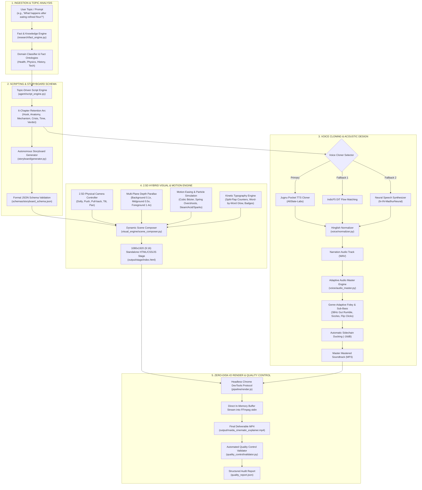

# PaperMotion AI — System Architecture

---

## Architectural Principles

### 1. Topic Agnostic Decoupling
Earlier iterations coupled the rendering pipeline to a hardcoded historical script (`Ashoka Samrat`). PaperMotion 2.0 decouples topic ingestion from visual execution. Any topic is transformed into an abstract `StoryboardPlan` conforming to `schemas/storyboard_schema.json`, ensuring infinite scalability across scientific, historical, medical, and technical disciplines.

### 2. Multi-Plane 2.5D Parallax Physics
Flat 2D animation suffers from rapid viewer disengagement. PaperMotion employs a 3-layer parallax camera model:
- **Background Layer ($z \approx -400\text{px}$, Parallax factor $0.1\times - 0.2\times$)**: Aged parchment canvases, vignette textures, scorched perimeter burns.
- **Midground Layer ($z \approx 0\text{px}$, Parallax factor $0.5\times - 1.0\times$)**: Anatomical organs, wheat kernels, clashing swords, nuclear reactor fuel rods.
- **Foreground Layer ($z \approx +200\text{px}$, Parallax factor $1.2\times - 1.4\times$)**: Rising steam particles, boiling acid flares, flying sparks, mechanical flip-tiles.
- **Overlay Layer**: Kinetic typography, highlighted keyword banners, and chapter milestone badges positioned safely within 9:16 social reel margins.

### 3. Frame-Accurate Zero-Disk CDP Memory Pipe
Rather than rendering thousands of `.png` image frames to disk—which introduces disk I/O bottlenecks and SSD wear—PaperMotion AI utilizes Chrome DevTools Protocol (`Page.captureScreenshot`). Uncompressed raw frame buffers are written directly into an active FFmpeg standard input pipe (`ffmpeg -f image2pipe -i -`). This achieves maximum render speed with zero temporary disk artifacts.

### 4. Broadcast EBU R128 Audio Compliance
Voiceover intelligibility is preserved through dynamic sidechain ducking. When narration occurs, background Foley soundscapes are automatically compressed by $-16\text{ dB}$. The final render is inspected by `quality_control/validator.py` ensuring $-14\text{ LUFS} \pm 1.5\text{ LUFS}$ integrated loudness and peak levels under $-1.0\text{ dBTP}$.
