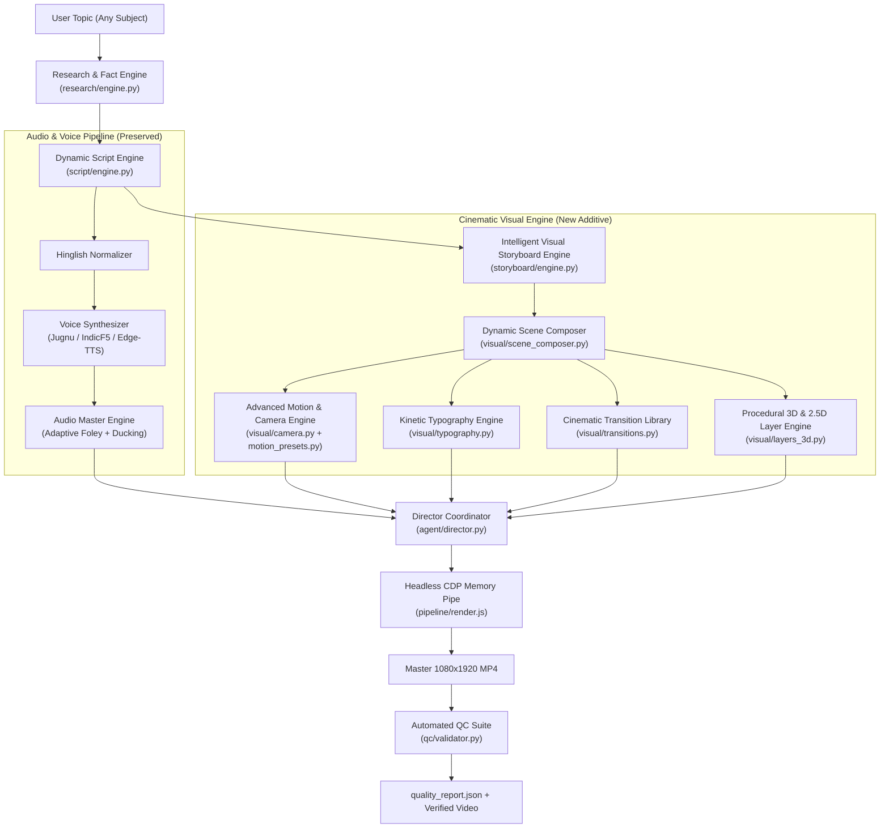

# PaperMotion AI: Architectural & Codebase Upgrade Audit

**Audit Date**: 2026-11-08  
**System Target**: Windows 11 / AMD Ryzen / 8 GB RAM / NVIDIA RTX 2050 (4 GB VRAM)  
**Primary Objective**: Upgrade Paper Motion Agent into a professional, topic-driven, cinematic explainer video production system without breaking existing pipelines.

---

## 1. Existing Architecture Overview

The existing repository implements a micro-documentary generation pipeline:
- **CLI Layer (`cli.py`)**: Click-based CLI providing `generate` and `preview` commands.
- **Agent Director (`agent/director.py`)**: Coordinates scripting, voice cloning, audio mastering, and CDP rendering.
- **Script Engine (`agent/script_engine.py`)**: Hardcoded 6-chapter dataclass structure for Ashoka Samrat.
- **Voice Pipeline (`voice/`)**:
  - `jugnu_cloner.py`: Kyutai Pocket TTS / Jugnu wrapper for zero-shot cloning.
  - `indicf5_engine.py`: IndicF5 DiT flow-matching with Vocos neural vocoder fallback.
  - `normalizer.py`: Regex-based Hinglish number and abbreviation expander.
  - `audio_master.py`: Procedural synthesis of war drums, bansuri flute, blade clashes, and FFmpeg sidechain ducking.
- **Motion Components (`motion/`)**:
  - `cutouts.py`: Procedural SVG sword clashes and 24-spoke Ashoka Chakra.
  - `flip_counter.py`: HTML generator for vintage split-flap number counters.
  - `paper_canvas.py`: Procedural canvas script generator for aged parchment fibers.
  - `typography.py`: Font imports and chapter badges.
- **Rendering Engine (`pipeline/`)**:
  - `cdp_streamer.py`: Python wrapper around `render.js`.
  - `render.js`: Headless Chrome DevTools Protocol (CDP) WebSocket pipe streaming raw JPEG frame buffers directly into FFmpeg stdin.
- **Templates (`templates/`)**:
  - `mayank_notebook`: Ashoka historical documentary parchment canvas.
  - `health_explainer`: Maida indigestion physiological explainer canvas.
- **Samples (`samples/`)**: Pre-rendered master MP4s, soundtracks, and PNG chapter previews.

---

## 2. Existing Working Components

1. **Headless Chrome CDP Memory-Pipe Renderer (`pipeline/render.js` + `pipeline/cdp_streamer.py`)**:
   - Bit-perfect frame-accurate rendering driven by `window.setSeekTime(t)`.
   - 0% disk write bloat (direct RAM-to-FFmpeg pipe).
   - Solid performance (~8.5 - 12.0 FPS on RTX 2050 / Ryzen CPU).
2. **Audio Sidechain Ducking (`voice/audio_master.py`)**:
   - FFmpeg `sidechaincompress` cleanly ducking BGM under narration.
3. **Hinglish Text Normalizer (`voice/normalizer.py`)**:
   - Converts numerals and units into phonetically speakable words.
4. **Voice Fallback Mechanism (`voice/jugnu_cloner.py` & `voice/indicf5_engine.py`)**:
   - Graceful fallback structure when model gates or hardware lack GPU VRAM.
5. **Interactive Studio Preview (`cli.py preview`)**:
   - Node-based live timeline scrubbing.
6. **Unit Test Suite (`tests/`)**:
   - 8 unit tests covering audio master, cutouts, and normalizer passing in 1.4s.

---

## 3. Broken, Incomplete & Hard-coded Components

| Component | Location | Severity | Identified Issue |
| :--- | :--- | :--- | :--- |
| **Topic Ignored** | `agent/director.py:49` | **CRITICAL** | `director.produce_documentary()` completely ignores the `--topic` argument and always calls `self.script_engine.get_ashoka_samrat_script()`. |
| **Fixed Duration** | `agent/director.py:56` | **CRITICAL** | Fixed `narration_duration = 22.31` hard-coded regardless of actual audio length or scene count. |
| **Hard-coded Reference Text** | `agent/director.py:78` | **HIGH** | Passes hard-coded `ref_text="Ashoka Samrat"` to IndicF5. |
| **Hard-coded Template** | `agent/director.py:99` | **CRITICAL** | Always points to `templates/mayank_notebook/index.html`. Unrelated topics get rendered on an Ashoka war notebook. |
| **Single Script in Engine** | `agent/script_engine.py` | **HIGH** | Only provides `get_ashoka_samrat_script()`. No research engine or dynamic topic expansion. |
| **Ashoka-Specific BGM** | `voice/audio_master.py:43` | **MEDIUM** | `generate_cinematic_bgm()` exclusively synthesizes war nagada drums and bansuri flute. |
| **Static Visual Elements** | `templates/*/style.css` | **MEDIUM** | Flat SVG cutouts with limited 2.5D depth, no dynamic camera pan/zoom/tilt, and no procedural 3D elements. |
| **Missing QC Gate** | `agent/director.py` | **HIGH** | Director terminates immediately after FFmpeg encoding without inspecting loudness, black frames, or frozen holds. |

---

## 4. Missing Functionality (Gaps to Professional Standard)

1. **Topic & Research Engine**: No mechanism to take an arbitrary user topic (e.g., *"What happens inside your body after eating refined flour?"* or *"How do black holes form?"*), extract key verified facts, and structure a subject-appropriate chapter count.
2. **Intelligent Storyboard Engine**: No structured, validated schema (`storyboard_schema.json`) detailing scene objectives, camera vectors, lighting, depth layers, particle effects, and transitions per scene.
3. **Hybrid Cinematic Visual Engine**:
   - Missing 2.5D multi-plane parallax depth.
   - Missing dynamic camera movements (dolly in/out, pan, tilt, orbital sweep).
   - Missing procedural 3D rendering (lightweight Three.js / WebGL / CSS 3D).
4. **Cinematic Transition Library**: Transitions are limited to basic CSS opacity fades between entire sections rather than directional wipes, mask reveals, and zoom cuts.
5. **Dynamic Scene Generator**: No system to dynamically construct the HTML/SVG/Canvas stage based on the generated storyboard.
6. **Automated Quality Control Suite**: No post-render validation generating structured `quality_report.json` with broadcast loudness (-14 LUFS) and frozen frame detection.

---

## 5. Dependency & Hardware Risk Analysis

- **Target System Specs**: AMD Ryzen CPU, 8 GB RAM, NVIDIA RTX 2050 (4 GB VRAM), Windows 11.
- **VRAM Constraints**: 4 GB VRAM is insufficient for running heavy local diffusion video models (e.g. Wan 2.2, HunyuanVideo require 16-24 GB VRAM).
- **Architecture Solution**:
  - Rely on **procedural code-to-video rendering** (HTML5 Canvas + Three.js + SVG + CSS 3D transforms).
  - Use GPU acceleration in Chrome DevTools Protocol (`--enable-webgl`, hardware acceleration flags where supported, with transparent CPU fallback).
  - Audio generation via lightweight neural TTS (`edge-tts` / `jugnu-pocket-tts` lite / `indicf5` CPU mode).
  - Zero heavy VRAM memory spikes during rendering.

---

## 6. Proposed Additive Architecture

---

## 7. File Preservation & Modification Strategy

### A. Files That MUST Remain Untouched (Strict Preservation)
- `voice/jugnu_cloner.py`: Preserved in its entirety.
- `voice/indicf5_engine.py`: Preserved in its entirety.
- `voice/normalizer.py`: Preserved in its entirety.
- `pipeline/render.js`: Preserved in its entirety (core CDP memory pipe).
- `pipeline/cdp_streamer.py`: Preserved in its entirety.
- `assets/*`: Existing reference audio clips and soundtracks preserved.
- `samples/*`: Existing Ashoka and Maida showcase videos preserved.
- `tests/test_audio_master.py`: Kept intact.
- `tests/test_cutouts.py`: Kept intact.
- `tests/test_normalizer.py`: Kept intact.

### B. Files That Will Be Upgraded / Extended (Additive & Backward-Compatible)
- `agent/director.py`: Add topic-driven routing, dynamic duration calculation, dynamic storyboard generation, and automated QC hooks. Default behavior gracefully falls back if no topic is provided.
- `agent/script_engine.py`: Retain `get_ashoka_samrat_script()`, add `generate_script(topic, language)` for arbitrary topics.
- `voice/audio_master.py`: Retain existing Ashoka methods, add adaptive multi-genre Foley synthesis (`science_tech`, `health_bio`, `curious_explainer`).
- `cli.py`: Add `--profile`, `--preset`, and `--skip-qc` flags while maintaining existing CLI arguments.

### C. New Additive Modules to Introduce
- `schemas/`:
  - `storyboard_schema.json`: Formal JSON Schema for visual scene definitions.
  - `scene_schema.json`: Formal schema for camera, lighting, and layer configurations.
- `research/`:
  - `fact_engine.py`: Fact extraction, concept breakdown, and knowledge structuring.
- `storyboard/`:
  - `generator.py`: Converts script chapters into validated multi-layer visual storyboards.
- `visual_engine/`:
  - `camera.py`: 2.5D camera coordinates, dolly/pan/tilt/zoom interpolation.
  - `motion_presets.py`: Bézier curves, spring dynamics, and particle systems.
  - `typography.py`: Kinetic typography, word highlights, and split-flap counters.
  - `transitions.py`: Directional wipes, zoom cuts, mask reveals, and light flashes.
  - `scene_composer.py`: Assembles complete HTML5/SVG/WebGL stages from storyboards.
- `quality_control/`:
  - `validator.py`: Automated loudness, frozen-frame, black-gap, and duration checks producing `quality_report.json`.
- `tests/`:
  - `test_research_engine.py`
  - `test_storyboard_schema.py`
  - `test_camera_motion.py`
  - `test_topic_director.py`
  - `test_quality_control.py`
